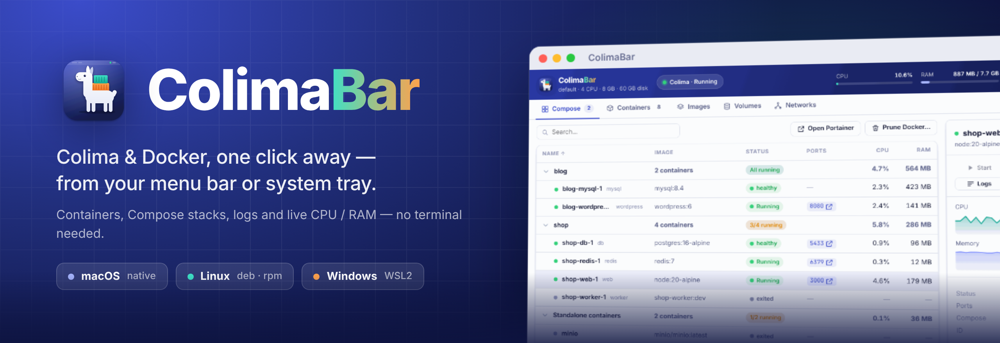
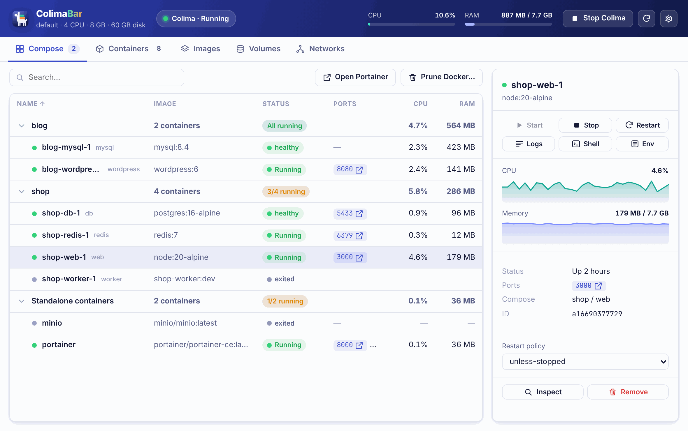
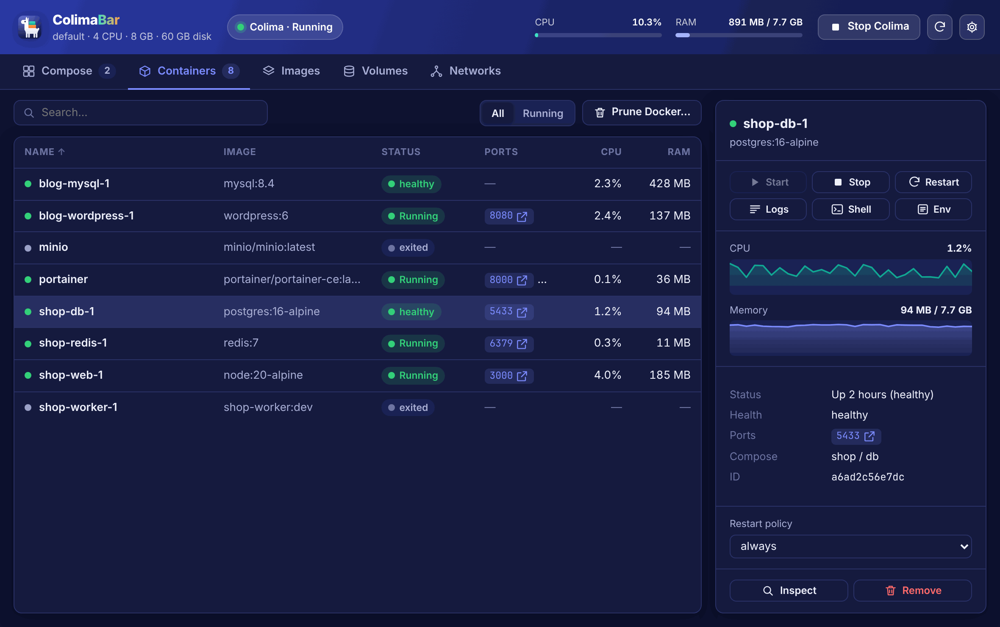
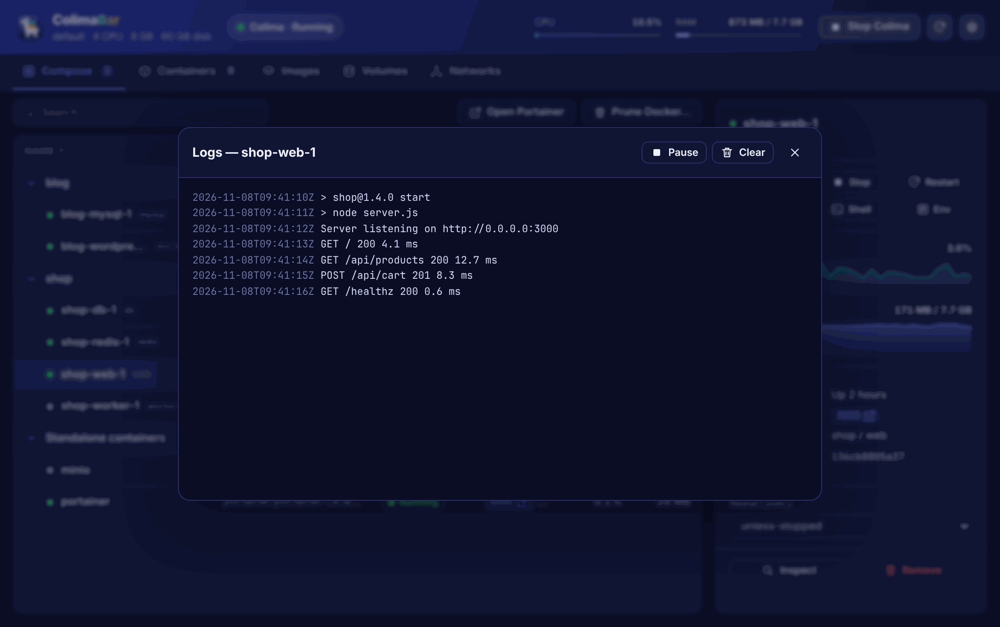

<p align="center">
  
</p>

<p align="center">
  
  
  
  
  <a href="https://github.com/DamienGdn/colimaBar/actions/workflows/swift.yml"></a>
  <a href="https://github.com/DamienGdn/colimaBar/actions/workflows/desktop.yml"></a>
</p>

<p align="center">
  <b>ColimaBar</b> puts <a href="https://github.com/abiosoft/colima">Colima</a> and Docker one click away.<br>
  Start and stop the engine, watch containers live, browse Compose stacks, images, volumes and networks — without opening a terminal.
</p>

<p align="center">
  <a href="#install">Install</a> ·
  <a href="#features">Features</a> ·
  <a href="#screenshots">Screenshots</a> ·
  <a href="#usage">Usage</a> ·
  <a href="#troubleshooting">Troubleshooting</a> ·
  <a href="#development">Development</a> ·
  <a href="CHANGELOG.md">Changelog</a>
</p>

---

## Highlights

- **One click to start / stop Colima** — status icon with a live badge (green running, orange starting, dimmed stopped)
- **Compose-aware** — containers grouped by project, with stack health and aggregate CPU / RAM
- **Everything per container** — start / stop / restart, live logs, shell, env vars, inspect, restart policy, CPU & RAM sparklines
- **Images, volumes & networks** — pull, delete, prune, see which containers use what
- **Stays out of the way** — lives in the menu bar (macOS) or system tray (Linux / Windows), with notifications for crashes and resource spikes
- **Native where it matters** — AppKit on macOS; a lightweight Tauri app on Linux and Windows. French & English, light & dark.

## Install

| Platform | App | Engine it drives | Get it |
|---|---|---|---|
| **macOS 13+** (Apple Silicon) | Native AppKit menu bar app | Colima | [Build from source](#macos) |
| **Linux** (x86_64) | Tauri system-tray app | Colima if installed, otherwise the local Docker daemon | `.deb` · `.rpm` · `AppImage` from [Releases](https://github.com/DamienGdn/colimaBar/releases) |
| **Windows 10 / 11** | Tauri system-tray app | Docker Desktop, or Docker Engine in WSL2 | `.exe` installer from [Releases](https://github.com/DamienGdn/colimaBar/releases) |

Development builds of the Linux and Windows packages are also attached to each run of the [Desktop workflow](https://github.com/DamienGdn/colimaBar/actions/workflows/desktop.yml) (*Artifacts*).

### macOS

Requirements: macOS 13 (Ventura) or later · Apple Silicon · Xcode Command Line Tools · Homebrew.

```bash
brew install colima docker                       # 1. dependencies
git clone https://github.com/DamienGdn/colimaBar.git
cd colimaBar && make install                     # 2. build + install to /Applications
open /Applications/ColimaBar.app                 # 3. launch
```

> [!NOTE]
> The app is ad-hoc signed. On first launch: right-click → **Open** → **Open anyway**.

### Linux

Install Docker (or [Colima](https://github.com/abiosoft/colima#installation)), then one of the packages:

```bash
sudo apt install ./ColimaBar_*_amd64.deb         # Debian / Ubuntu
sudo dnf install ./ColimaBar-*.x86_64.rpm        # Fedora / RHEL / openSUSE
chmod +x ColimaBar_*.AppImage && ./ColimaBar_*.AppImage   # any distribution
```

Your user must be able to run `docker` without `sudo` (`sudo usermod -aG docker $USER`, then log out and back in).

### Windows

1. Install **Docker Desktop**, *or* Docker Engine inside a WSL2 distribution.
2. Run `ColimaBar_<version>_x64-setup.exe` (per-user install, no admin rights needed).
3. With Docker only inside WSL2, ColimaBar falls back to `wsl -e docker` automatically; you can also set it in **Settings → Docker command**.

> [!NOTE]
> The installer is not code-signed yet: on the SmartScreen prompt choose **More info** → **Run anyway**.

## Features

| | macOS | Linux | Windows |
|---|:---:|:---:|:---:|
| Status icon with live badge, notifications | ✅ | ✅ | ✅ |
| Start / stop Colima, choose profile (instance) | ✅ | ✅ ¹ | — |
| CPU / memory / disk for the VM | ✅ | ✅ ¹ | — |
| Docker Desktop / WSL2 / custom Docker CLI | — | ✅ | ✅ |
| Compose projects, containers (search, sort, filter) | ✅ | ✅ | ✅ |
| Start / stop / restart, live logs, shell, env, inspect | ✅ | ✅ | ✅ |
| Restart policy, CPU & RAM sparklines, clickable ports | ✅ | ✅ | ✅ |
| Images (pull / delete), volumes & networks (prune) | ✅ | ✅ | ✅ |
| Portainer install / open, `docker system prune` | ✅ | ✅ | ✅ |
| Crash & resource alerts (CPU > 80 %, RAM > 90 %) | ✅ | ✅ | ✅ |
| Launch at login, FR / EN, light & dark | ✅ | ✅ | ✅ |
| Resource profiles, disk resize, compact mode, Colima update check | ✅ | — | — |

<sub>¹ When Colima is installed. Without it, ColimaBar manages the local Docker daemon.</sub>

<details>
<summary><b>Full macOS feature list</b></summary>

#### Colima lifecycle

- **Start / Stop Colima** — stops automatically when you quit the app
- **Adaptive polling** — 5 s refresh when running, 30 s when stopped (Fast / Normal / Slow presets)
- **Status icon** — monochrome llama glyph that follows the menu bar appearance, with a green badge (running), orange badge (starting/stopping), dimmed glyph (stopped)
- **Lifecycle notifications** — Starting, Started (with duration + container count), Stopping, Stopped
- **Crash notification** — alert when a container exits unexpectedly
- **Last error in menu** — visible directly in the menu, clears on next success
- **Multi-instance switcher** — "Instance" submenu switches between Colima instances
- **Auto-start Colima** — optional: start Colima automatically when the app launches
- **Colima update detection** — `Colima X.Y.Z update available` when Homebrew has a newer version
- **Launch at login** — app only; Colima auto-start is a separate opt-in setting

#### Containers

- **Containers panel** — table with state, name, image, status, restart policy, ports, CPU %, RAM; sortable columns, search, All / Running filter
- **Container actions** — Start / Stop / Restart / Logs / Shell / Env per selected container, plus a right-click menu (copy ID, open port, filter by image, restart policy, inspect)
- **Per-container CPU & RAM** — live stats per row, aggregate totals in the header, sparklines for the selected container
- **Health checks** — colored indicator per container
- **Clickable ports** — each port opens `http://localhost:PORT`
- **Custom exec command** — the Shell button asks for the command to run (default `sh`)
- **In-app logs viewer** — streams `docker logs -f`, follow / stop, clear, 5 000-line cap

#### Compose, images, volumes & networks

- **Compose tab** (default) — containers grouped by project, expandable rows, search, sparklines, actions and context menu
- **Images** — list with size and date, pull, delete
- **Volumes** — size and the containers using each volume, prune unused
- **Networks** — driver and scope, prune unused
- **Portainer** — auto-opens after Colima starts, installs if missing
- **Prune Docker…** — `docker system prune` with confirmation

#### Settings

- **Profiles** — Minimal (1 CPU / 2 GB), Dev (2 CPU / 4 GB), Heavy (4 CPU / 8 GB), or individual CPU / memory / disk presets
- **Disk resize** — without the CLI
- **Compact mode** — running container count next to the menu bar icon
- **Resource alerts** — CPU > 80 % or RAM > 90 % for 2 consecutive cycles
- **Language** — follows the system, or French / English

</details>

## Screenshots

### Linux & Windows

| Compose (light) | Containers (dark) |
|---|---|
|  |  |

<p align="center"></p>

<sub>Rendered with the built-in demo data (`npm run preview` in <code>tauri/</code>).</sub>

### macOS

The macOS app is a native AppKit menu bar app: a status menu plus a popover panel with the same tabs (Compose, Containers, Images, Volumes, Networks), SF Symbols and system controls. Its look differs from the Linux / Windows window above; screenshots of the redesigned version will be added here.

## Usage

**macOS** — click the llama in the menu bar. **Linux / Windows** — use the tray icon menu, or the window (left-click the tray icon on Windows). Closing the window keeps ColimaBar running in the tray.

<details>
<summary><b>macOS: where is what</b></summary>

| Action | How |
|--------|-----|
| Start / stop Colima | Click icon → Start Colima / Stop Colima |
| View containers | Click icon → N/M containers… |
| Search / filter containers | Panel → search field · All / Running toggle |
| Start, stop, restart a container | Panel → select container → Start / Stop / Restart |
| Shell, logs, env vars | Panel → select container → Shell / Logs / Env |
| Copy container ID, inspect, restart policy | Right-click a container |
| Images: pull, delete | Panel → Images tab |
| Volumes / networks: prune | Panel → Volumes / Networks tab → Prune… |
| Open / install Portainer | Click icon → Open Portainer · Install Portainer… |
| Prune Docker | Click icon → Prune Docker… |
| Settings | Click icon → Settings… (⌘,) |
| Profiles, CPU / memory / disk, instance | Settings |
| Language, launch at login, auto-start Colima | Settings |
| Upgrade Colima | Click icon → update item (shown when available) |
| About / version | Click icon → About ColimaBar |

</details>

<details>
<summary><b>Linux / Windows: shortcuts</b></summary>

| Action | How |
|--------|-----|
| Search | `Ctrl+F` |
| Settings | `Ctrl+,` or the gear button |
| Refresh now | `F5` / `Ctrl+R` |
| Live logs of a container | Double-click its row, or **Logs** in the detail panel |
| Open a published port | Click the port badge |
| Collapse / expand a Compose project | Click the project row |

</details>

## Troubleshooting

<details>
<summary><b>macOS: "ColimaBar can't be opened"</b></summary>

The app is ad-hoc signed: right-click → **Open** → **Open anyway** (or System Settings → Privacy & Security → **Open anyway**).
</details>

<details>
<summary><b>Linux: no tray icon (GNOME)</b></summary>

Vanilla GNOME has no tray area. Install the *AppIndicator and KStatusNotifierItem Support* extension, or keep using the window: it opens at launch unless **Settings → Start hidden** is enabled.
</details>

<details>
<summary><b>Linux: "Docker is not reachable"</b></summary>

Start the daemon (`sudo systemctl start docker`) and make sure your user is in the `docker` group. With Colima, start it from the app or with `colima start`.
</details>

<details>
<summary><b>Windows: Docker only inside WSL2</b></summary>

ColimaBar uses `wsl -e docker` automatically when no Windows `docker` CLI is found. To force a specific distribution, set **Settings → Docker command** to `wsl -d Ubuntu -e docker`.
</details>

<details>
<summary><b>Reset Portainer credentials</b></summary>

```bash
docker rm portainer
docker volume rm portainer_data
docker run -d -p 8000:8000 -p 9443:9443 --name portainer --restart=always \
  -v /var/run/docker.sock:/var/run/docker.sock \
  -v portainer_data:/data portainer/portainer-ce:latest
```

Open https://localhost:9443 (accept the self-signed certificate) to create a new admin account.
</details>

## Development

### macOS app (Swift / AppKit)

```bash
make build    # compile release binary
make bundle   # create ColimaBar.app (ad-hoc signed)
make install  # bundle + install to /Applications
make open     # install + launch
make test     # run the test suite (custom runner, no Xcode / XCTest needed)
make clean    # remove build artifacts
```

### Linux & Windows app (Tauri 2)

```bash
cd tauri
npm install          # Tauri CLI
npm run dev          # run the app
npm run build        # release bundles for the current OS
npm run preview      # UI only, in a browser, with demo data
cd src-tauri && cargo test
```

System dependencies and project layout: [`tauri/README.md`](tauri/README.md).

### Brand assets

All artwork is vector and lives in [`design/`](design); `make icons` re-renders every icon (needs Node + Playwright).

| File | Used for |
|---|---|
| `design/AppIcon.svg` | App icon (64 px and up): macOS `.icns`, Tauri icons, `docs/icon.png` |
| `design/AppIcon-small.svg` | Simplified icon for 16 – 48 px renditions |
| `design/MenuBarIcon.svg` | macOS menu bar template glyph |
| `design/banner.html` | README banner → `docs/banner.png` (1280×440 @2x) |
| `design/social-preview.html` | GitHub social preview → `docs/social-preview.png` (1280×640) |

Palette: indigo `#3B4CCA` · navy `#121A4A` · teal `#12A894` · orange `#F26B1D`.

<details>
<summary><b>Repository layout</b></summary>

```
Sources/
├── ColimaBarCore/                 # Pure Foundation library (testable)
│   ├── ShellRunner.swift          # Process execution + Homebrew PATH injection
│   ├── ColimaState.swift          # State model + ResourceUsage
│   ├── DockerContainer.swift      # Container model + ports parser + health
│   ├── DockerImage.swift · DockerVolume.swift · DockerNetwork.swift
│   ├── ColimaManager.swift        # Polling, start/stop/prune, docker commands
│   ├── ColimaConfig.swift         # Preferences + profiles + polling presets
│   └── Localization.swift         # FR/EN strings + language preference
└── ColimaBar/                     # AppKit executable
    ├── AppDelegate.swift          # Lifecycle, SMAppService, notifications
    ├── StatusBarController.swift  # NSStatusItem, menu, status icon, alerts
    ├── Theme.swift                # SF Symbols, status dots, brand colors
    ├── ContainersPanelViewController.swift # Compose/Containers/Images/Volumes/Networks
    ├── SettingsPanelViewController.swift   # Settings popover
    ├── LogsWindowController.swift # In-app `docker logs -f` viewer
    ├── EnvVarsViewController.swift · SparklineView.swift · main.swift
Tests/ColimaBarTests/              # Custom test runner
Resources/                         # Info.plist, AppIcon.icns, menu bar glyph
tauri/                             # Linux & Windows edition (Rust backend + web UI)
design/                            # Vector sources for all artwork
scripts/                           # render-icons.mjs (SVG → PNG/ICO), pack-icns.py
.github/workflows/                 # swift.yml (macOS) · desktop.yml (Linux & Windows)
```

</details>

## Credits

Built on [Colima](https://github.com/abiosoft/colima), [Docker](https://www.docker.com/), [Portainer](https://www.portainer.io/) and [Tauri](https://tauri.app). ColimaBar is an independent project, not affiliated with any of them.
