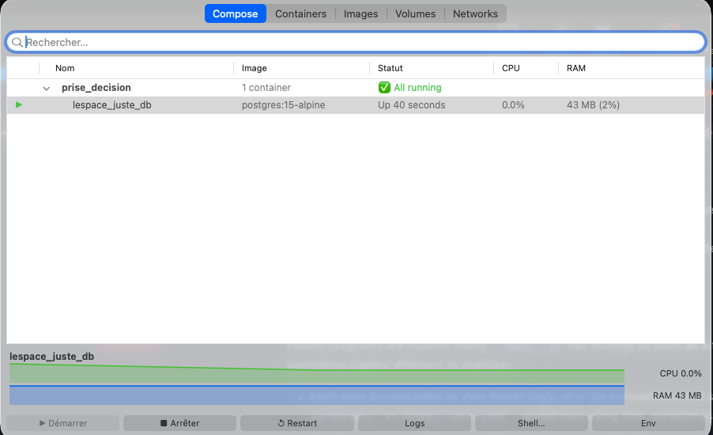
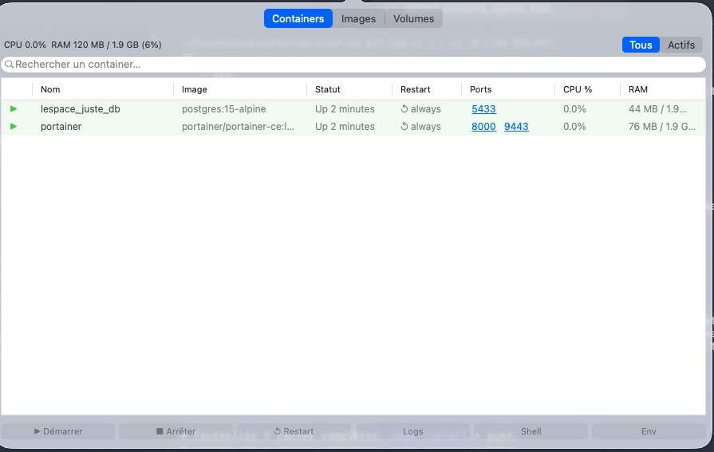
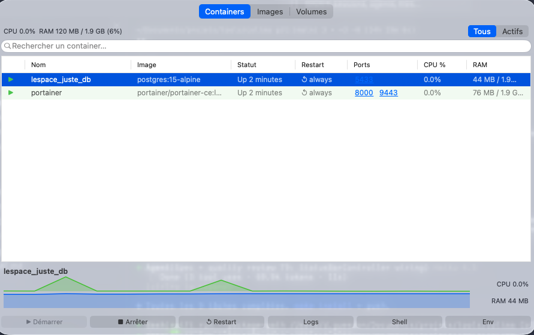
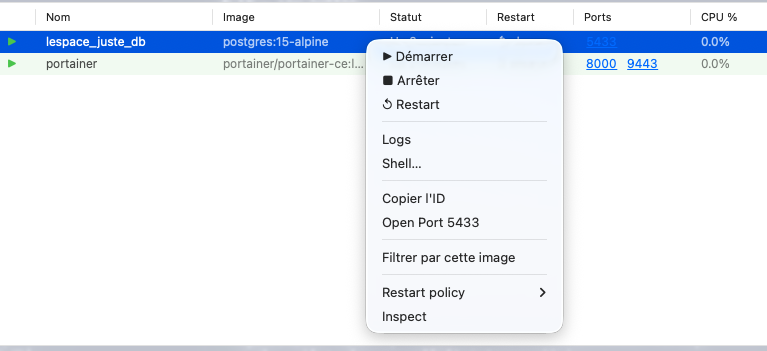
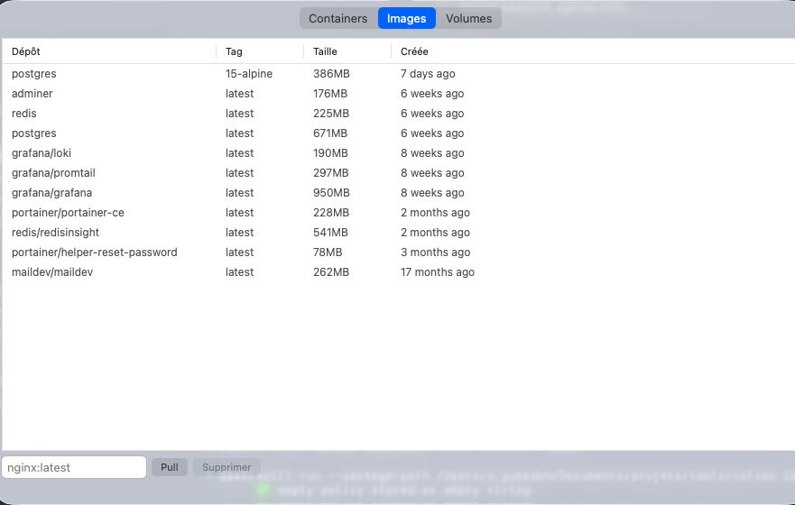
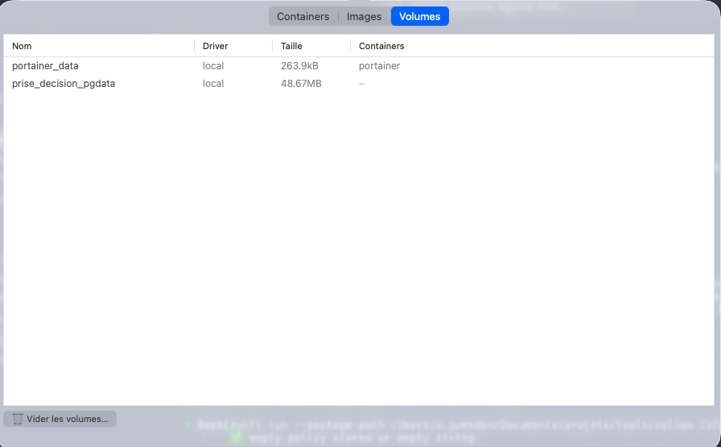
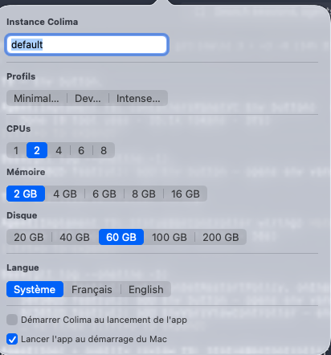

<p align="center">
  
</p>

<p align="center">
  
  
  
  
  <a href="https://github.com/DamienGdn/colimaBar/actions/workflows/swift.yml"></a>
</p>

**ColimaBar** is a native macOS menu bar app for [Colima](https://github.com/abiosoft/colima) — a lightweight Docker Desktop alternative.
Start and stop your VM, watch containers live, browse Compose projects, images, volumes and networks, and tune resources without opening a terminal.

<p align="center">
  <a href="#install">Install</a> ·
  <a href="#features">Features</a> ·
  <a href="#screenshots">Screenshots</a> ·
  <a href="#usage">Usage</a> ·
  <a href="#development">Development</a> ·
  <a href="CHANGELOG.md">Changelog</a>
</p>

---

## Install

**Requirements:** macOS 13 (Ventura) or later · Apple Silicon · Xcode Command Line Tools · Homebrew

```bash
# 1. Dependencies
brew install colima docker

# 2. Build & install
git clone https://github.com/DamienGdn/colimaBar.git
cd colimaBar
make install

# 3. Launch
open /Applications/ColimaBar.app
```

> [!NOTE]
> The app is ad-hoc signed. On first launch: right-click → **Open** → **Open anyway**.

Portainer (optional) runs at **https://localhost:9443** — accept the self-signed certificate on first visit.

## Features

### Colima lifecycle

- **Start / Stop Colima** — stops automatically when you quit the app
- **Adaptive polling** — 5 s refresh when running, 30 s when stopped
- **Status icon** — monochrome llama glyph that follows the menu bar appearance, with a green badge (running), orange badge (starting/stopping), dimmed glyph (stopped)
- **Lifecycle notifications** — Starting, Started (with duration + container count), Stopping, Stopped
- **Crash notification** — alert when a container exits unexpectedly
- **Last error in menu** — `⚠ error message` visible directly in menu, clears on next success
- **Multi-instance switcher** — "Instance" submenu switches between Colima instances
- **Named Colima instances** — configure the active instance name (default, dev, prod…)
- **Auto-start Colima** — optional: start Colima automatically when the app launches
- **Colima update detection** — `Colima X.Y.Z update available` when brew has a newer version
- **Launch at login** — app only, Colima auto-start is a separate opt-in setting

### Containers

- **Containers panel** — rich NSPopover with table view: state, name, image, status, ports, CPU%, RAM columns
- **Sortable columns** — click any header to sort by name, ports, CPU%, or RAM
- **Container search** — filter containers by name in real time
- **Container actions** — Start / Stop / Restart / Logs / Shell per selected container
- **Shell into container** — opens `docker exec -it <name> sh` in Terminal
- **Container filter** — toggle All / Running only (persisted)
- **Per-container CPU & RAM** — live stats per row: CPU%, used / limit (%) — refreshed every 5 s
- **Real-time aggregate CPU & RAM** — totals + global RAM% shown in panel header
- **Health check status** — `●` colored indicator (green/yellow/red) per container showing health check state
- **Clickable port URLs** — each port number in the panel is a link, click opens `http://localhost:PORT` in browser
- **CPU/RAM sparklines** — mini area chart history (up to 20 points) shown in detail zone when a container is selected
- **Restart policy** — column showing each container's restart policy (always / on-failure / unless-stopped)
- **Restart policy change** — right-click → Restart policy → select a new policy
- **Context menu** — right-click any container row: start/stop/restart, logs, shell, copy ID, open port, filter by image, inspect
- **Custom exec command** — Shell button prompts for the command to run (default `sh`)
- **Environment variables** — Env button opens a popover with all KEY=VALUE env vars; copy-all button
- **Quick filter by image** — context menu → "Filter by this image" fills the search field instantly
- **Exposed ports** — host port numbers shown per container
- **Copy container ID** — one click copies the full container ID to clipboard
- **In-app logs viewer** — floating window streams `docker logs -f` inline; follow/stop toggle, clear button, 5 000-line cap
- **Quick logs** — opens `docker logs -f` in Terminal

### Compose, images, volumes & networks

- **Image management** — "Images" tab: list all images with size and date, pull new images, delete existing ones
- **Volume management** — "Volumes" tab: list all volumes with size and associated containers, prune unused volumes
- **Networks tab** — lists Docker networks (driver, scope); prune unused networks
- **Compose tab** — default tab; groups containers by Docker Compose project; search field; expandable rows with per-container details (status, CPU%, RAM) + sparklines; action bar and right-click context menu on each container
- **Portainer integration** — auto-opens after Colima starts, installs if missing
- **docker system prune** — `Prune Docker…` with confirmation dialog

### Settings

- **Polling interval presets** — Rapide (2 s) / Normal (5 s, default) / Lent (15 s) configurable in Settings
- **Compact mode** — optionally show running container count next to the menu bar icon (`▶ N`)
- **Disk resize** — resize Colima disk from Settings without CLI
- **Resource alerts** — notification when CPU > 80 % or RAM > 90 % for 2 consecutive cycles
- **Settings popover** — replaces the Configuration submenu, includes all options
- **Profiles** — Minimal (1 CPU / 2 GB), Dev (2 CPU / 4 GB), Heavy (4 CPU / 8 GB)
- **CPU / Memory / Disk fine-tuning** — individual presets in Settings
- **French / English** — follows system language, manual toggle in Settings

## Screenshots

| Compose | Containers |
|---|---|
|  |  |

| Sparklines CPU/RAM | Context menu |
|---|---|
|  |  |

| Images | Volumes |
|---|---|
|  |  |

<p align="center"></p>

## Usage

| Action | How |
|--------|-----|
| Start Colima | Click icon → Start Colima |
| Stop Colima | Click icon → Stop Colima |
| View containers | Click icon → N/M containers… |
| Search containers | Panel → search field |
| Filter containers | Panel → All / Running toggle |
| Start/stop a container | Panel → select container → Start or Stop |
| Restart a container | Panel → select container → Restart |
| Shell into a container | Panel → select container → Shell |
| View container logs | Panel → select container → Logs |
| See per-container stats | Panel → select any running container |
| Copy container ID | Panel → select container → Copy ID |
| Open Portainer | Click icon → Open Portainer |
| Install Portainer | Click icon → Install Portainer… (shown when missing) |
| Prune Docker | Click icon → Prune Docker… (shown when running) |
| Open Settings | Click icon → Settings… (⌘,) |
| Apply a profile | Settings → Profiles → Minimal / Dev / Heavy |
| Change CPU / Memory / Disk | Settings → CPUs / Memory / Disk |
| Set Colima instance name | Settings → Colima Instance |
| Auto-start Colima | Settings → Auto-start Colima on launch |
| Change language | Settings → Language |
| Launch at login | Settings → Launch app at login |
| Upgrade Colima | Click icon → update item (shown when available) |
| View images | Panel → Images tab |
| Pull an image | Panel → Images tab → type name → Pull |
| Delete an image | Panel → Images tab → select → Delete |
| View volumes | Panel → Volumes tab |
| Prune volumes | Panel → Volumes tab → Prune volumes… |
| About / version | Click icon → About ColimaBar |

## Reset Portainer credentials

```bash
docker rm portainer
docker volume rm portainer_data
docker run -d -p 8000:8000 -p 9443:9443 --name portainer --restart=always \
  -v /var/run/docker.sock:/var/run/docker.sock \
  -v portainer_data:/data portainer/portainer-ce:latest
```

Open https://localhost:9443 to create a new admin account.

## Development

```bash
make build    # compile release binary
make bundle   # create ColimaBar.app (ad-hoc signed)
make install  # bundle + install to /Applications
make open     # install + launch
make test     # run the test suite (swift run ColimaBarTests)
make icons    # re-render icons from design/*.svg (needs Node + Playwright, macOS iconutil)
make clean    # remove build artifacts
```

Tests use a small custom runner (no Xcode / XCTest required).

### Brand assets

All artwork is vector and lives in [`design/`](design):

| File | Used for |
|---|---|
| `design/AppIcon.svg` | App icon → `Resources/AppIcon.icns`, `docs/icon.png` |
| `design/MenuBarIcon.svg` | Menu bar template glyph → `Resources/colimabar.png` / `@2x` |
| `design/banner.html` | README banner → `docs/banner.png` |

Palette: indigo `#3B4CCA` · navy `#121A4A` · teal `#12A894` · orange `#F26B1D`.

### Architecture

```
Sources/
├── ColimaBarCore/                 # Pure Foundation library (testable)
│   ├── ShellRunner.swift          # Process execution + Homebrew PATH injection
│   ├── ColimaState.swift          # State model + ResourceUsage
│   ├── DockerContainer.swift      # Container model + ports parser + health
│   ├── DockerImage.swift          # Image model
│   ├── DockerVolume.swift         # Volume model
│   ├── DockerNetwork.swift        # Network model
│   ├── ColimaManager.swift        # Polling, start/stop/prune, docker commands
│   ├── ColimaConfig.swift         # Preferences + profiles + polling presets
│   └── Localization.swift         # FR/EN strings + language preference
└── ColimaBar/                     # AppKit executable
    ├── main.swift                 # NSApplication entry point
    ├── AppDelegate.swift          # Lifecycle, SMAppService, notifications
    ├── StatusBarController.swift  # NSStatusItem, menu, status icon, alerts
    ├── Theme.swift                # SF Symbols, status dots, brand colors
    ├── ContainersPanelViewController.swift # Compose/Containers/Images/Volumes/Networks popover
    ├── SettingsPanelViewController.swift   # Settings popover
    ├── LogsWindowController.swift # In-app `docker logs -f` viewer
    ├── EnvVarsViewController.swift # Env vars popover
    └── SparklineView.swift        # CPU/RAM area chart
Tests/ColimaBarTests/              # Custom test runner
Resources/                         # Info.plist, AppIcon.icns, menu bar glyph
design/                            # Vector sources for all artwork
scripts/render-icons.mjs           # SVG → PNG renderer
```

## Credits

Built on [Colima](https://github.com/abiosoft/colima), [Docker](https://www.docker.com/) and [Portainer](https://www.portainer.io/). ColimaBar is an independent project, not affiliated with any of them.
