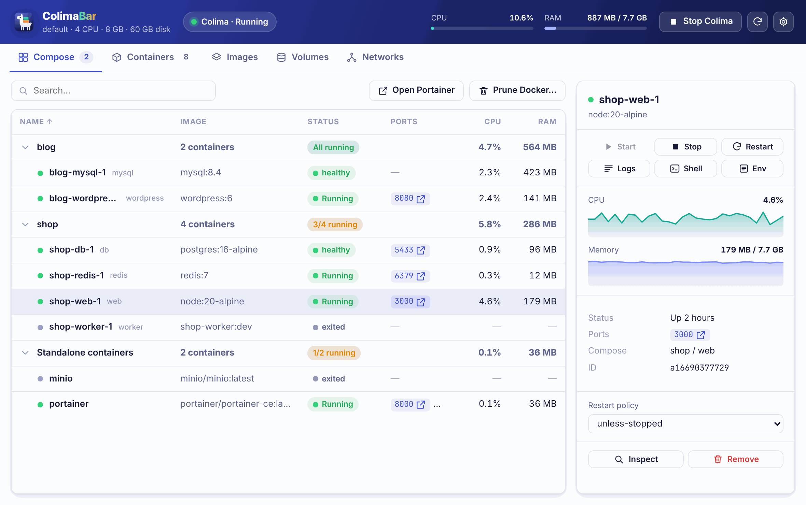
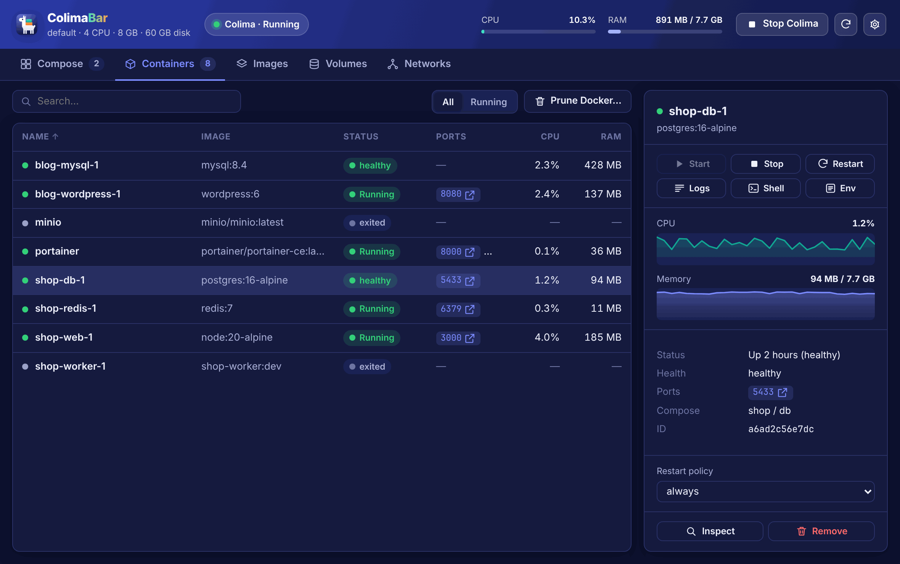
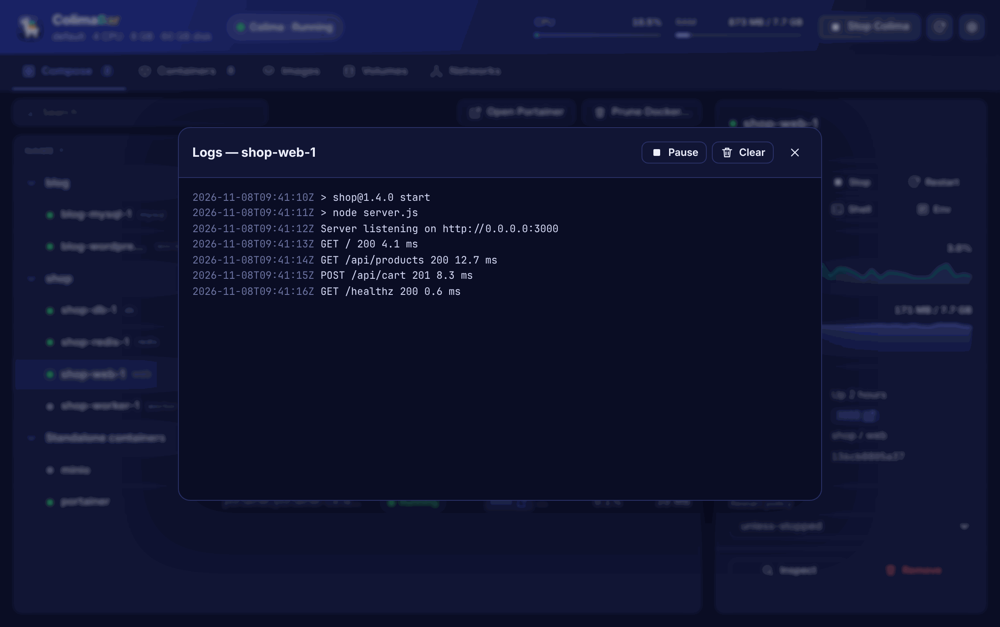

# ColimaBar for Linux & Windows

Cross-platform edition of ColimaBar, built with [Tauri 2](https://tauri.app) (Rust backend + web UI).
The native macOS app (AppKit, repository root) is unchanged; this folder ships the **Linux** and **Windows** builds.

<p align="center"></p>

## What it manages

| Platform | Engine | Start / stop engine |
|---|---|---|
| Linux | **Colima** when installed (and enabled in Settings), otherwise the local **Docker** daemon | Colima only |
| Windows | **Docker Desktop**, or **Docker Engine in WSL2** (`wsl -e docker`, auto-detected when no Windows `docker` CLI exists) | — |

Any Docker-compatible CLI can be used via **Settings → Docker command** (e.g. `wsl -e docker`, `podman`).

## Features

- **System tray** — status icon (green: running, orange: starting/stopping, grey: stopped), live CPU/RAM, start/stop Colima, open Portainer, prune, settings, quit. Closing the window keeps the app in the tray; a single instance runs at a time.
- **Compose tab** — containers grouped by Compose project, with aggregate CPU/RAM and health of the stack
- **Containers tab** — sortable table (name, image, status, ports, CPU, RAM), All / Running filter, search (`Ctrl+F`)
- **Detail panel** — start / stop / restart, live logs, shell (opens your terminal), env vars, inspect JSON, remove, restart policy, CPU & memory sparklines
- **Live logs** — streams `docker logs -f` (stdout + stderr), pause / resume, clear, 5 000-line cap
- **Images** (pull, remove, prune dangling), **Volumes** (used-by, prune), **Networks** (prune)
- **Notifications** — engine started / stopped, container crashed, CPU > 80 % / RAM > 90 % for two cycles
- **Settings** — language (system / FR / EN), refresh interval, Docker command, Colima profile + CPU / memory / disk, auto-start Colima, launch at login, start hidden
- Light & dark themes follow the OS

| Containers (dark) | Live logs |
|---|---|
|  |  |

<sub>Screenshots use the built-in demo data (`npm run preview`).</sub>

> [!NOTE]
> On desktops without a tray area (vanilla GNOME needs the *AppIndicator* extension) the window stays the main entry point: it opens at launch unless **Start hidden** is enabled.

## Install

Download the latest build from the **Actions** artifacts or a GitHub **Release**:

| OS | Package |
|---|---|
| Debian / Ubuntu | `ColimaBar_<version>_amd64.deb` (`sudo apt install ./ColimaBar_*.deb`) |
| Fedora / openSUSE | `ColimaBar-<version>-1.x86_64.rpm` |
| Any Linux | `ColimaBar_<version>_amd64.AppImage` (`chmod +x` then run) |
| Windows 10 / 11 | `ColimaBar_<version>_x64-setup.exe` (per-user installer) or `.msi` |

Requirements: Docker (or Colima) installed. On Windows, WebView2 is installed automatically if missing.

## Develop

```bash
cd tauri
npm install                 # Tauri CLI
npm run dev                 # run the app with hot reload of src/
npm run build               # release bundles for the current OS
npm run preview             # UI only, in a browser, with demo data (no Docker needed)

cd src-tauri && cargo test  # parser unit tests
```

Linux build dependencies (Debian/Ubuntu):

```bash
sudo apt install libwebkit2gtk-4.1-dev libayatana-appindicator3-dev librsvg2-dev libxdo-dev build-essential
```

Windows: [Rust](https://rustup.rs), Node.js 20+, and the *Desktop development with C++* workload of Visual Studio Build Tools.

The demo mode accepts query parameters for screenshots, e.g.
`?lang=fr&tab=containers&select=shop-db-1`, `?state=stopped`, `?state=unavailable&backend=docker&os=windows`, `?modal=settings`.

## Layout

```
tauri/
├── src/                    # Web UI (vanilla JS modules, no bundler)
│   ├── index.html · styles.css · app.js
│   ├── api.js              # Tauri IPC + demo backend for browser preview
│   ├── i18n.js · icons.js
│   └── assets/logo.svg
└── src-tauri/              # Rust backend
    ├── src/model.rs        # Data model + CLI output parsers (unit-tested)
    ├── src/engine.rs       # Backend detection, docker / colima commands, terminals
    ├── src/lib.rs          # Poller, commands, notifications, settings
    ├── src/tray.rs         # Tray icon + menu
    ├── icons/              # Generated by `make icons` (from design/*.svg)
    └── tauri.conf.json
```

CI: `.github/workflows/desktop.yml` lints and tests on Linux, then builds Linux (`deb`, `rpm`, `AppImage`) and Windows (`nsis`, `msi`) bundles. Pushing a `v*` tag attaches them to the GitHub release.
